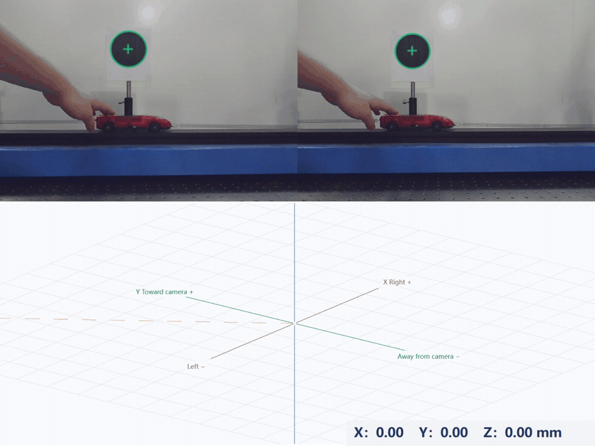
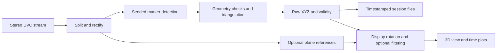

<div align="center">

# Stereo Motion Measurement

**From stereo camera images to inspectable 3D motion.**

A Windows desktop application for tracking a black circular marker, visualizing its trajectory, and reviewing recorded measurements.


[Get started](#quick-start) · [Features](#features) · [Algorithms](#how-it-works) · [Data](#data-and-session-format) · [Limitations](#known-limitations) · [Roadmap](#roadmap)

**A software made by Siri.y**

</div>



## Overview

Stereo Motion Measurement brings stereo acquisition, marker detection, triangulation, visualization, and session management into one desktop interface. It is intended for small-scale motion experiments, educational stereo-vision work, and investigation of practical tracking problems.

The project started from an interest in VR-style handheld tracking: seeing a real object's movement appear as a three-dimensional trajectory on screen. The current release focuses on a simpler, inspectable target: **one solid black circle on a light background**.

**Configure camera → create or import calibration → activate and save → select the marker in both views → track → save → replay.**

Raw measurements remain available alongside derived coordinates and filtered estimates. Tracking failures are recorded explicitly instead of being silently replaced with a predicted path.

> **Current scope:** single-marker position tracking. Colored-ball tracking, geometric sphere-center estimation, multiple objects, and IMU integration are future work. This release does not provide complete 6-DoF VR tracking or general-purpose scene reconstruction.

## What is new in v0.2.0

- **Camera setup in the sidebar:** device scanning, configurable capture backend, packed stereo layout, requested resolution/FPS, pixel format, eye order, and actual-stream preview.
- **Guided stereo calibration:** at least 30 accepted pairs, pose suggestions, measured cell width/height, coverage and tilt checks, held-out geometric checks, and explicit activation.
- **Calibration import and binding:** supported NPZ/OpenCV exports are checked against geometry, actual image size, capture settings, and file digest before use.
- **More flexible environment references:** checkerboard auto-detection or optional square counts, optional cell dimensions, all-corner robust fitting, better candidate continuity, and geometry scaled to analysis resolution.
- **Lighting diagnostics and a bounded enhancement fallback** for checkerboard assistance, plus time-plot, taskbar-icon, bilingual-layout, and failure-message fixes.

IMU development is separate from this desktop release. USB/BLE six-axis communication has been exercised on a development ESP32-C3/MPU6050 assembly, but the application does **not** yet receive IMU data, estimate fused pose, or track colored balls.

## Contents

- [Quick start](#quick-start)
- [Hardware and calibration](#hardware-and-calibration)
- [Camera setup and calibration workflow](#camera-setup-and-calibration-workflow)
- [Features](#features)
- [Using the application](#using-the-application)
- [Coordinates and reference frames](#coordinates-and-reference-frames)
- [How it works](#how-it-works)
- [Data and session format](#data-and-session-format)
- [Run and build from source](#run-and-build-from-source)
- [Validation and performance](#validation-and-performance)
- [Troubleshooting](#troubleshooting)
- [Known limitations](#known-limitations)
- [Roadmap](#roadmap)
- [Contributing](#contributing)
- [Acknowledgments and licensing](#acknowledgments-and-licensing)

## Quick start

### Portable Windows application

1. Open [Releases](https://github.com/sirikiki/Stereo-Motion-Measurement/releases) and download the versioned Windows x64 RAR asset. WinRAR or another RAR-capable extractor is required. **Code → Download ZIP** contains source code, not the ready-to-run application.
2. Extract the **entire** archive to a writable folder. Do not run the EXE from inside the archive.
3. Keep `Stereo Motion Measurement.exe`, `_internal`, `assets`, `config`, and `calibration` together in the extracted application folder.
4. Double-click `Stereo Motion Measurement.exe`. Python is not required for the portable application.

The app starts with the camera off. You can inspect its interface and load a compatible recording without connecting a camera.

### First tracking session

1. Connect your stereo camera and close other apps using it.
2. Open **Camera setup** in the sidebar, between **Playback** and **Settings**.
3. Find the device, select its packed layout and stream settings, and start preview. Confirm the correct left/right views and actual image dimensions.
4. Follow [Camera setup and calibration workflow](#camera-setup-and-calibration-workflow). **Create a calibration or import one for your own rig; you do not need to do both.** Activate it and save camera setup.
5. Return to **Monitor**, click **Open camera**, and place one black circular marker on a light card in the shared field of view.
6. Click its center in each camera image, then **Start tracking**. Move only after valid XYZ appears.
7. Click **Stop tracking** to finish and save. In **Sessions**, choose the recording and click **Play session**.

Camera preview can work without calibration. Metric XYZ and environment analysis require a valid, matching, activated calibration. If tracking is lost, check visibility and lighting, then reselect the marker in both views; reselection also works during tracking.

## Hardware and calibration

| Requirement | Supported scope |
| --- | --- |
| Operating system | Windows x64; tested on Windows 11 |
| Camera input | One OpenCV-accessible UVC device returning two equally sized views in one packed frame |
| Packed layout | Side by side or top/bottom; optional left/right swap |
| Optical model | OpenCV pinhole lenses, a rigid stereo assembly, and rectification with horizontal disparity |
| Capture backend | DirectShow, Media Foundation, or OpenCV Auto |
| Pixel format request | MJPG, YUY2, or Default; decoded 8-bit gray/BGR/BGRA frames |
| Tracking target | One solid black circle with a light surrounding region |
| Graphics | An OpenGL-capable graphics driver |

The development rig used a DECXIN-3412V1 integrated UVC module, requested MJPG at 2560 × 960 / 60 FPS, with two 1280 × 960 views. These are **historical test settings**, not requirements for all devices and not shipping camera bindings.

Separate USB cameras, vendor-specific SDKs, raw Bayer/16-bit streams, fisheye models, and vertical-disparity stereo reconstruction are not currently supported. A top/bottom *image arrangement* does not imply support for a vertical physical stereo baseline. A supported stream format does not certify hardware exposure synchronization; confirm that with the camera supplier.

Fresh settings use device 0, Auto backend, Default format, a **1280 × 480 / 30 FPS request**, and side-by-side layout. These are editable starting values, **not automatic discovery of your camera's best mode**. Preview shows negotiated dimensions and observed delivery rate. If the two images are wrong, cropped, or swapped, correct the profile before calibration. Device indices can change after reconnection.

Use a rigid mount, stable normal lighting, a matte marker, and a flat calibration board. Set focus before calibration. Recheck calibration after changing focus, resolution, crop, eye order, or relative camera geometry. Moving the whole rigid rig does not necessarily invalidate its internal stereo parameters, but previous environment references must be reset.

### Device-specific calibration

**No original developer calibration is included in the v0.2.0 portable package.** Each camera needs its own calibration, even another unit of the same model. Preview requires only a suitable camera stream; metric measurement requires appropriate intrinsics, distortion, and stereo extrinsics.

Calibration computes each lens's intrinsic parameters and distortion, plus the relative rotation and translation between the two cameras. It is different from **Environment reference**, which establishes display directions after stereo calibration.

## Camera setup and calibration workflow

**Connection and preview → create OR import calibration → confirm and activate → save camera setup → Monitor.** Importing is an alternative to capturing a new calibration, not an extra mandatory stage after computation.

### 1. Connect and verify the stream

1. Plug the rig into the computer. In **Camera setup → 1 · Connection**, scan for a device or enter its index. A scan checks OpenCV access, not camera model/serial identity.
2. Choose **Side by side** or **Top / bottom** and enter the *total packed* width/height. A 2560 × 960 side-by-side frame has 1280 × 960 per eye.
3. Choose backend and pixel format; start preview and inspect both views. Correct swapped eyes before calibration.
4. Check actual dimensions, reported FPS, and observed frame delivery. The driver may negotiate differently from your request. Stop other software using the camera.

| Option | Meaning |
| --- | --- |
| **AUTO backend** | OpenCV chooses an available Windows capture backend; it does not identify the lens or obtain calibration. |
| **DSHOW / MSMF** | Explicit DirectShow / Media Foundation access. Device/driver behavior varies. |
| **MJPG** | Requests JPEG-compressed video, often useful for higher USB stream rates; compression can affect fine detail. |
| **YUY2** | Requests uncompressed YUV 4:2:2, with greater bandwidth demands at the same dimensions/rate. |
| **DEFAULT format** | Leaves format choice to the driver/backend; inspect the actual stream rather than assuming a format. |

### 2A. Create a calibration in the application

1. Print a checkerboard accurately and attach it flat to a rigid backing. Disable printer scaling and measure the resulting cells; entered dimensions determine metric scale.
2. In **2 · Capture calibration**, enter **square columns × rows**, counting the outer squares. For example, 10 × 7 squares contain 9 × 6 inner corners.
3. Enter the measured **cell width × height in millimeters**. Enter both values, including equal values for square cells. These dimensions are required for metric stereo calibration.
4. Keep the cameras and focus fixed. Move the board through the suggested center/edge positions, distances, and left/right/up/down tilts. Let it settle before each **Capture pair**. Both eyes must see the complete board and its border. The indicated angles are suggestions, not measured pose angles.
5. Collect **at least 30 accepted pairs**. Repeated images of the same pose are insufficient. The app checks spatial coverage, scale variation, and tilt diversity.
6. Click **Compute and check**. Review fitting errors and held-out geometric/length checks. If rejected, improve the indicated coverage or image quality and capture more pairs. Thirty pairs alone do not guarantee a pass.
7. In **3 · Results and import**, click **Confirm and activate**. Confirm that the file belongs to this physical rig, focus, resolution, and eye order.
8. Click **Save camera setup**, then return to Monitor.

Captured calibration images and rejected attempts are retained locally under `data/calibration_runs/`. A failed candidate does not silently replace an existing active calibration. A computed result is written as a candidate; activation saves a separate user calibration under `calibration/`.

### 2B. Import an existing calibration instead

Choose **Import calibration** in the results tab and select a compatible `.npz`, OpenCV `.yml`/`.yaml`, or `.xml` file for this rig. For OpenCV text exports, specify the actual translation-vector unit (**m** or **mm**); do not guess. Files from arbitrary tools are not automatically interchangeable.

<details>
<summary><strong>Import schema and validation</strong></summary>

NPZ loading disables pickle. The original physical parameters must include `K_left`, `D_left`, `K_right`, `D_right`, `R`, `T`, per-eye `image_size`, and scalar `units="m"`. Text-file aliases include `K_left` / `M1` / `K1`, `K_right` / `M2` / `K2`, `D_left` / `D1`, `D_right` / `D2`, `R`, and `T`; image dimensions can use `image_size` or `image_width` / `image_height`.

Derived `R1`, `R2`, `P1`, `P2`, and `Q` are recomputed from physical parameters and checked for consistency. The importer validates finite values, matrix shapes, supported distortion models, baseline plausibility, and usable horizontal rectification. It does not establish that the file belongs to the connected physical camera.

</details>

Preview the matching stream, **Confirm and activate**, then **Save camera setup**. There is no need to capture 30 new pairs if a suitable calibration already exists. Finally validate measurements with an independently measured distance.

### Existing-user upgrade

Keep your old application/data folder as a backup; extract v0.2.0 into a new writable folder. Import your own original calibration, or use **Review current calibration** when a local file is already configured. Reconfirm the physical device, focus, resolution and eye order, activate, and save. Configuration and file-hash binding are safeguards, **not hardware serial-number recognition**. Do not copy the developer's calibration into another user's rig.

## Features

| Area | Available now |
| --- | --- |
| **Monitor** | Stereo preview, marker overlays, live XYZ, full-session 3D trajectories, independent preview and recording |
| **3D interaction** | Rotate, pan, zoom, Monitor expand/restore, front/top/side views, fit trajectory, follow latest point, camera-origin visibility |
| **Position modes** | Absolute camera-origin coordinates and displacement from the session's first valid point, switchable live and in playback |
| **Filtering** | Optional One Euro filtering; raw measurements remain available |
| **Environment reference** | Independent horizontal/vertical references, automatic candidates, manual region guidance, checkerboard assistance |
| **Time plots** | Separate X/Y/Z curves from current or loaded sessions |
| **Accuracy validation** | General A1 → B → A2 displacement, stationary variation, and return-deviation checks |
| **Sessions** | Automatic saving, metadata, notes, folder access, single/batch deletion, undo for the most recent deletion batch |
| **Playback** | CSV loading, play/pause, seeking, 0.25× / 0.5× / 1× / 2× speeds, direct access to curves and return |
| **Camera setup** | Device/stream configuration, actual preview, guided capture, stereo calibration, supported file import, activation and binding |
| **Settings** | English/Simplified Chinese, depth limits, video, diagnostic images, reference protection |

Collapse the sidebar or independently hide images, trajectory, XYZ, and detection overlays. Hiding a display does not stop measurement and saving.

## Using the application

### Monitor and 3D controls

| Control | Action |
| --- | --- |
| **Open camera / Close camera** | Toggle preview; closing during tracking finalizes the session |
| **Start tracking / Stop tracking** | Create and finish an automatically saved session |
| Left-click a camera image | Select/reselect the marker in that view |
| Left-drag the 3D view | Rotate |
| Middle-drag | Pan |
| Mouse wheel | Zoom |
| Double-click the 3D view | Reset and fit |
| Expand icon on Monitor | Expand into the work area; click again or press **Esc** to restore |
| **Center trajectory** | Fit the currently available trajectory |
| **Follow target** | Center the latest valid point; manual view manipulation can interrupt following |
| **Camera origin** | Show/hide the optical-origin marker, label, and guide |
| **Front XZ / Top XY / Side YZ** | Select a standard view |
| **Absolute / Relative** | Change position reference without rewriting raw XYZ |
| **Filter off / Filter on** | Switch raw/filtered display |

The full current-session trajectory is retained rather than disappearing after a rolling time window. Very long recordings can therefore increase memory and rendering cost.


### Time plots

Choose **Time plots** to inspect X, Y, and Z against elapsed time. Select the current or last loaded session, or import a compatible CSV. The curves use the applicable display orientation and position/filter modes. Invalid observations create gaps.

Plots can reveal depth changes or cross-axis motion that is difficult to judge from a 3D viewing angle. From **Playback**, the blue **Time plots** button opens the loaded recording's curves; **Back** returns to playback.


### Optional environment reference

A tilted camera can make physically level motion change several camera coordinates. A user-selected reference defines which direction should represent horizontal or vertical. The transform is a rigid rotation: it does not flatten real motion or improve underlying depth measurements.

Set references **before a session**:

1. Open the camera and navigate to **Environment reference**.
2. Choose **Auto** or **Manual** at the top right.
3. Select **Horizontal plane** or **Vertical plane**. Either can be set alone; both and either order are supported.
4. **Auto:** keep the scene still until a stable candidate appears. Hover over an outline to preview a grid; left-click to confirm.
5. **Manual:** right-click at least three points in either image, then click the first point to close the outline. This suggests an approximate region; the software searches in and around it for a supported plane. **Backspace** removes a point; **Esc** resets an unfinished outline.
6. **Clear** removes references. During manual analysis, cancellation is available instead.

| Reference | Orientation |
| --- | --- |
| None | Default camera-based convention |
| Horizontal only | Z follows the upward plane normal; other directions remain close to the default |
| Vertical only | Default up is retained; the plane refines horizontal heading |
| Both | Horizontal defines up and vertical refines heading; incompatible directions are rejected |

An unset/active reference uses red feedback, an accepted reference green, and an existing reference blue while the other type is selected. Grids appear only on this page. They indicate fitted orientation and supported area, not a semantic outline of an entire desk or wall.

For weak texture, enable **Checkerboard assistance**. Its optional fields appear beside the button without shifting the images. Leave the square counts blank for automatic detection, or enter **columns × rows of squares** to prioritize that pattern. For example, 10 × 7 squares contain 9 × 6 inner corners. Automatic search covers supported candidates; it is not a promise to recognize every possible pattern or partially visible board.

Cell width × height in millimeters is **optional for this direction-reference workflow**: metric depth already comes from calibrated stereo. When supplied, dimensions provide a consistency check. This is different from stereo calibration, where measured cell dimensions are mandatory. Place the board against the actual horizontal/vertical reference surface and keep it fully visible in both views.

The reference uses all detected, geometrically accepted corners with robust plane fitting; it is no longer restricted to the center or tied to a single printed board size. Inner corners are the reliable detection features; an outer grid outline is a fitted/extrapolated display, not an independent measurement of every outside edge. Slight board imperfections may be tolerated, but bent paper is not a known plane. An arbitrary slanted plane is not a horizontal/vertical reference.

Candidate continuity reduces flicker, but loss of support eventually withdraws the candidate; a retained grid is not permission to confirm an occluded or stale board. If detection fails, check the square counts, full visibility, focus, and calibration before enlarging the search area.

Lighting feedback describes observed brightness/contrast differences. If the normal checkerboard path fails and the image has usable structure, one bounded CLAHE fallback may be attempted. Original images remain unchanged, and geometric rejection gates remain in place. This does not make dark, blurred, reflective, or textureless surfaces universally detectable.

References can be reused across sessions while the application and reference workflow remain active. Occlusion alone does not delete them. Clear them after moving the camera. Closing the application or camera reference workflow clears active references; saved sessions retain their own snapshots for playback.

**Reference protection** uses background features and repeated geometric consistency checks to look for camera movement. By default, confirmation clears the reference, stops and saves tracking, and shows an alert. With **Stop tracking when camera movement is confirmed** disabled, raw recording continues while invalid environment-coordinate display is suspended. A scene with insufficient background information can prevent reliable movement detection.


### Accuracy validation: A1 → B → A2

This checks a known displacement and return repeatability, independently of pendulum analysis.

1. Fix the marker to a support with a repeatable positioning reference.
2. Establish A and B using a measured separation; prefer a guide or stops over freehand positioning.
3. Enter **Reference displacement**, in millimeters.
4. Start tracking and confirm valid XYZ.
5. Hold at A and click **Record A1 · 5 s**.
6. Move to B, hold still, and click **Record B · 5 s**.
7. Return to A, hold still, and click **Return to A · 5 s**.
8. Review measured displacement, difference from the reference, each stage's standard deviations, and return-to-A deviation.

A stage participates only with at least **20 valid points**, **80% valid frames**, and **4.5 seconds** of coverage. Repeated attempts are retained; the latest attempt for each stage is used.

Static standard deviation measures short-term variation, not absolute accuracy. Reference spacing, positioning, marker geometry, and calibration uncertainty still matter.

### Sessions and playback

Each run has its own timestamped directory. **Sessions** shows counts, valid rate, and completion status. Notes are saved separately from raw CSV. **Open folder** opens the selected session directory.

Use the red trash button for a selected record, or **Batch delete** for several. Deleted sessions move to the application recycle folder. **Undo delete** restores the most recent deletion batch during the current application run.

Use **Play session** or **Playback → Open CSV / session** to replay. Stop active tracking first. Playback supports speed changes, timeline seeking, position/filter modes, and the recording's saved environment reference when available.

**Continuous video is not synchronized into playback in this release.** Coordinates and trajectories can play without video. A CSV without its report can be loaded, but missing metadata limits reconstruction of the original reference context.


### Settings

- **Language / 语言:** English or 简体中文. Close the camera first; switching saves the preference and rebuilds the idle interface.
- **Minimum / Maximum depth limit:** rejection thresholds in meters. Defaults 0.2 and 3.0 m are not a validated tracking range.
- **Camera configuration:** device/stream selection and calibration are now in the dedicated **Camera setup** sidebar page.
- **Video recording:** optional raw stereo MJPG video; off by default.
- **Diagnostic images:** optional original stereo images approximately every two seconds during recording; **off by default in the clean v0.2.0 distribution**.
- **Reference protection:** stop and save when camera movement is confirmed; on by default.

Click **Save settings** after changing these preferences, and **Save camera setup** after configuring the stream/calibration. Acquisition parameters are locked during tracking; visibility and the 3D view remain adjustable.


## Coordinates and reference frames

By default, directions are defined for a person facing the camera:

| Axis | Positive direction |
| --- | --- |
| **X** | The person's right |
| **Y** | Toward the camera |
| **Z** | Up in the camera-based convention |

Without an external reference these are camera-related directions, not measured gravity. Environment references rotate this convention.

Let `p` be the raw point in rectified first-camera coordinates, `R` the saved display rotation, and `p0` the first valid point after Start:

```text
absolute display position = R · p
relative display position = R · (p − p0)
```

- Absolute origin: the rectified first-camera optical center, not a surveyed laboratory origin.
- Relative origin: fixed at `p0` for the session.
- UI: millimeters. CSV fields ending `_m`: meters.
- Both coordinate modes are recorded alongside raw XYZ.
- Changing the 3D viewing angle does not change measurement coordinates.

## How it works



| Stage | Method | Source |
| --- | --- | --- |
| Rectification | OpenCV undistortion/rectification maps from stored calibration | `stereo_reconstruction.py` |
| Marker detection | Grayscale, bounded Otsu threshold, contours, image moments, contrast/shape/size checks near a seed | `marker_tracking.py` |
| Point reconstruction | Epipolar consistency, homogeneous triangulation, depth limits, reprojection rejection | `stereo_reconstruction.py` |
| Natural reference planes | StereoSGBM, optional brightness normalization and temporal depth median, robust/RANSAC-based fitting, connected support, multi-frame stability | `environment.py`, `plane_selection.py`, `plane_patches.py` |
| Checkerboard assistance | Pattern detection/corner continuity, stereo correspondence checks, triangulation, robust all-corner plane fitting, optional dimension consistency | `board_reference.py` |
| Stereo calibration | Corner refinement, individual camera calibration, fixed-intrinsics stereo calibration, rectification and held-out checks | `camera_setup.py`, `camera_dialog.py` |
| Image observations | Brightness/contrast diagnostics and bounded checkerboard CLAHE fallback | `image_quality.py` |
| Camera-movement checks | ORB matching and PnP/RANSAC with repeated confirmation | `environment.py` |
| Filtering | 3D speed-norm adaptation of One Euro | `filtering.py` |
| Persistence | Queued CSV writing, JSON metadata, explicit validity, timestamp-based playback | `storage.py`, `capture.py` |

Modules are under `source/`. Dense stereo is used for optional plane references; marker tracking triangulates the two detected image centers and does not require dense scene reconstruction for every target measurement.

One Euro adapts cutoff with estimated speed to trade smoothness against responsiveness. Filtering can lag and suppress real small motion. It cannot classify motion intent. Invalid input resets the filter, preserving gaps.

This project integrates established algorithms into an inspectable measurement workflow. It does not claim a new stereo or filtering algorithm.

## Data and session format

```text
Stereo Motion Measurement/
├── Stereo Motion Measurement.exe
├── _internal/                 # Bundled runtime; keep with EXE
├── assets/
├── VERSION.txt               # 0.2.0
├── calibration/              # Empty initially; activated user calibration later
├── config/
│   ├── defaults.json
│   └── settings.json          # Local preferences; ignored by Git
├── source/
├── data/calibration_runs/    # Created during user calibration
├── data/sessions/<session-id>/
│   ├── measurements.csv
│   ├── report.json
│   ├── calibration.npz
│   ├── user_annotations.json # If an annotation is saved
│   ├── diagnostic_images/     # If enabled
│   ├── raw.avi                # If enabled
│   └── error.txt              # On error
└── logs/application.log
```

Portable packages start without previous experiments. Data, logs, and recycle folders are generated as needed and excluded from source control.

<details>
<summary><strong>Important CSV fields</strong></summary>

| Field/group | Meaning |
| --- | --- |
| `host_read_complete_ns` | Monotonic host read-completion timestamp, nanoseconds |
| `valid` | Whether the implemented target checks passed |
| `x_m`, `y_m`, `z_m` | Raw rectified-camera XYZ, meters |
| `left_u_px`, `left_v_px`, `right_u_px`, `right_v_px` | Rectified image centers, pixels |
| `vertical_error_px`, `disparity_px` | Stereo consistency information |
| `reason` | Success/failure reason |
| `relative_camera_*_m` | Displacement from first valid point in raw camera axes |
| `display_absolute_*_m`, `display_relative_*_m` | Coordinates after the saved display rotation |
| `filtered_camera_*_m` | Filtered estimate, distinct from raw XYZ |
| `environment_valid` | Environment-reference validity |
| `phase`, `attempt`, `phase_elapsed_s` | Free-motion / validation-stage bookkeeping |
| `diagnostic_image` | Diagnostic image filename when saved for that row |

Invalid observations have explicit status and missing coordinates. Playback leaves gaps instead of interpolating measurements. `report.json` records settings, calibration SHA-256, coordinate-origin policy, environment snapshot/events, filter parameters, row counts, status, and available validation summaries. Keep it with the CSV.

</details>

### Timing and privacy

Host read completion is **not** hardware exposure time or measured end-to-end latency. Video uses a fixed-rate container based on reported/requested capture FPS; CSV host timestamps remain the measurement time reference, and variable delivery can make video timing differ.

The desktop app records locally and has no built-in telemetry or automatic cloud upload. The clean release excludes previous sessions, calibration captures, recycle contents, logs, Git history, and developer calibration/settings. Future recordings and calibration captures are generated locally. Diagnostic images/video may contain people, screens, or room details. Review them before sharing and select individual sessions deliberately.

## Run and build from source

The capture implementation targets Windows; other operating systems are unvalidated. Install **64-bit Python 3.11**, then use PowerShell:

```powershell
git clone https://github.com/sirikiki/Stereo-Motion-Measurement.git
cd Stereo-Motion-Measurement
py -3.11 -m venv .venv
.\.venv\Scripts\python.exe -m pip install -r requirements.txt
Copy-Item config/defaults.json config/settings.json
.\.venv\Scripts\python.exe source/app.py
```

Copy defaults only on a fresh checkout; do not overwrite existing preferences unnecessarily. Calling virtual-environment Python directly avoids needing a PowerShell activation-policy change.

See [`requirements.txt`](requirements.txt) for pinned NumPy, OpenCV, SciPy, PySide6, pyqtgraph, PyOpenGL, and PyInstaller versions. The current implementation needs no CUDA, PyTorch, ROS, or pretrained model.

### Build a portable folder

```powershell
.\.venv\Scripts\python.exe build.py
```

Output: `dist/Stereo Motion Measurement/`. Distribute the entire folder. The build uses `config/defaults.json` for initial settings and does not copy experiment history. Before distributing your own build, empty the source `calibration/` directory and review defaults: the build copies that directory, so personal calibration files placed there would otherwise be included. Build output, EXEs, runtime libraries, local settings, acquired data, and logs are ignored by Git.

### Offline GUI self-check

A clean portable copy can run without opening a camera:

```powershell
$env:SMM_QA_DIR = Join-Path $env:TEMP "StereoMotionQA"
& ".\Stereo Motion Measurement.exe" --smoke-test
```

This developer check expects no existing sessions. It uses temporary synthetic CSV data, exercises interface/playback, writes results and screenshots to the chosen QA directory, and exits. It is not a hardware or accuracy test and is not required for normal use.


## Validation and performance

The v0.2.0 workflow combines offline checks and limited real-device observations. These evidence types must not be treated as equivalent:

| Evidence | What it supports | What it does not establish |
| --- | --- | --- |
| Offline geometry, import, simulated degradation, negative inputs and GUI checks | Regression checks on implemented behavior | Performance or accuracy of an untested camera |
| User-operated checkerboard trials on the development rig | Successful normal-light, window-light/shadow and horizontal/vertical examples; recovery after single-eye occlusion | Universal weak-light robustness or arbitrary slanted-plane support |
| Development IMU USB/BLE communication | Separate hardware bring-up feasibility | IMU support in this desktop application or fusion accuracy |
| A1 → B → A2 procedure | A way to compare against your measured reference and inspect repeatability | A manufacturer-independent global accuracy specification |

Reported checkerboard computation examples were approximately 0.5–1 second on the development setup. These are observations, not latency guarantees; scene search can take substantially longer. Loss messages after occlusion can include candidate-retention time. Detection execution time, time until a visible result, capture rate, and end-to-end latency are different quantities.

Different camera models, first-time-user completion, exposure synchronization, and independent absolute accuracy have not been comprehensively validated. Use your own distance reference and examine raw failure reasons before trusting measurements.

## Troubleshooting

| Symptom | Checks and next steps |
| --- | --- |
| No image | Click **Open camera**; check device index, USB, Windows camera access, and competing camera apps. |
| Frame size differs from calibration | In Camera setup, verify actual packed dimensions and per-eye dimensions, then use the matching calibration. |
| Preview works but tracking/environment is blocked | Create/import the matching calibration, confirm and activate, then save camera setup. A changed profile/file may invalidate the binding. |
| Dark/blurred image | Remove covers, improve lighting, set physical focus, then check calibration applicability. |
| Visible target but no green circle | Select it in both views; check its light border, size, contrast, perspective, reflections, and occlusion. |
| No recovery after occlusion | Reselect. The current detector has a 100-pixel center-displacement gate; enlarging the ROI does not remove that gate. |
| Green circles but no XYZ | Green circles indicate 2D detection only; geometry/depth/reprojection checks can reject the pair. |
| Horizontal movement changes Z | Check camera tilt/reference and actual cross-axis motion; use a real level plane when needed. |
| Desk/wall rejected | Try a larger textured area, better lighting, or a flat checkerboard. Weak texture and mixed surfaces can defeat stereo. |
| Gaps in plots | Inspect CSV validity/reason and environment validity. Gaps represent rejected observations. |
| Slow 3D view | Try hiding images, reduce GPU load, check graphics drivers, and consider full-session trajectory cost. |
| Language will not switch | Close the camera first. |
| Copied EXE fails | Extract the whole portable archive and keep `_internal` beside the EXE. |

## Known limitations

- One seeded black-circle target on a light background; no arbitrary-object or colored-sphere support yet.
- Image-centroid triangulation is approximate. Perspective affects planar-circle centers; geometric sphere-center estimation is future work.
- Camera support is limited to the packed-UVC/pinhole/horizontal-disparity scope described above; configuration options do not imply every camera is supported.
- Large post-occlusion motion and similar dark distractors can defeat tracking; recovery is not guaranteed.
- Experimental plane references struggle with weak texture, reflections, clutter, shadows, and slanted surfaces. They do not semantically distinguish desks, walls, screens, and outlets.
- Filtering can alter real small motion and cannot infer intent.
- IMU input/fusion, complete 6-DoF tracking, synchronized video playback, and a global accuracy/latency specification are not provided. Guided stereo calibration is available; its checks are not independent accuracy certification.
- Full-session visualization has increasing memory/rendering cost for long recordings.

## Roadmap

These are intended priorities, not committed release dates.

- [x] Stereo preview, seeded marker tracking, quality-gated triangulation
- [x] Interactive trajectories, raw/filtered and absolute/relative displays
- [x] Automatic recording, metadata, session management, curves, CSV playback
- [x] Optional plane references and checkerboard assistance
- [x] English and Simplified Chinese interfaces
- [ ] Improve occlusion recovery, distractor handling, and failure diagnostics
- [ ] Add colored-ball tracking and evaluate geometric sphere-center estimation
- [x] Add camera configuration, guided stereo calibration, import and activation
- [x] Remove fixed checkerboard print-size assumptions from environment references
- [x] Add image-quality feedback and bounded checkerboard enhancement
- [ ] Broaden real-device compatibility and weak-texture/lighting evaluation
- [ ] Collect/time-align IMU data before evaluating fusion benefits
- [ ] Evaluate multiple objects after documenting a single-target operating envelope
- [ ] Publish selected, privacy-reviewed example sessions and repeatable evaluation procedures

## Contributing

Reproducible issues are useful. Include:

1. Revision, Windows version, and EXE versus Python execution.
2. Camera model, device index, actual frame size, and calibration context.
3. Reproduction steps and expected versus observed behavior.
4. Relevant error text and a short privacy-reviewed CSV/report or stereo image pair.
5. Whether environment references and filtering were enabled.

Distinguish captured data from synthetic inputs and preserve missing observations. Do not attach credentials or unreviewed personal footage. Source changes should explain the behavior and appropriate validation.

## Acknowledgments and licensing

- [OpenCV calibration and 3D geometry](https://docs.opencv.org/4.x/d9/d0c/group__calib3d.html): rectification, StereoSGBM, and triangulation.
- [NumPy](https://numpy.org/) and [SciPy](https://scipy.org/): numerical operations and optimization.
- [Qt for Python / PySide6](https://doc.qt.io/qtforpython-6/), [pyqtgraph](https://github.com/pyqtgraph/pyqtgraph), and [PyOpenGL](https://pyopengl.sourceforge.net/): interface and visualization.
- [One Euro Filter](https://github.com/casiez/OneEuroFilter), Casiez, Roussel, and Vogel, CHI 2012: adapted here using a 3D speed norm.
- [PyInstaller](https://pyinstaller.org/): portable Windows packaging.

Developed with AI-assisted software coding and debugging alongside hands-on setup, experiments, and user feedback. Established algorithms and external libraries are credited separately from project-specific engineering work.

**Project license selection is pending.** This README does not declare an MIT, Apache, or other project-wide license. Third-party components retain their own licenses; supplied dependency notices should be preserved with distributions.

---

<div align="center">

**A software developed by Siri.y — and no, not *that* Siri on your iPhone :D**

Built for experiments that can be inspected, replayed, and questioned.

</div>
