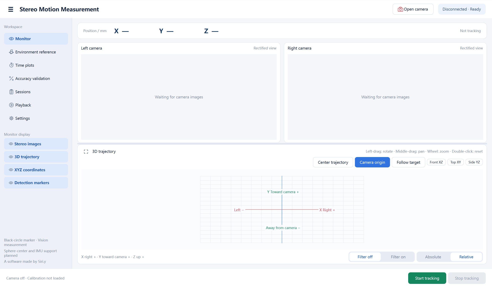
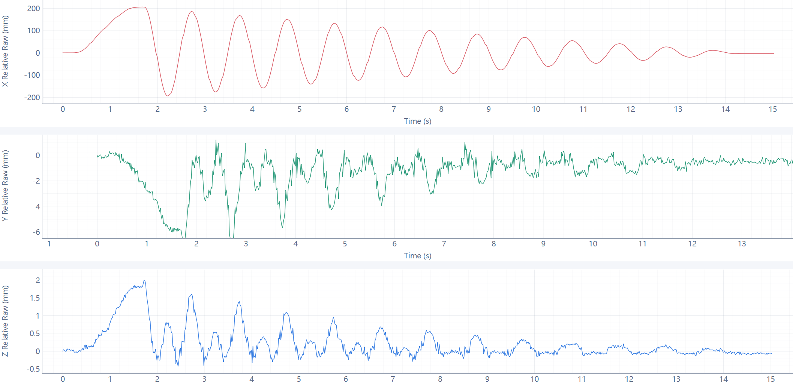
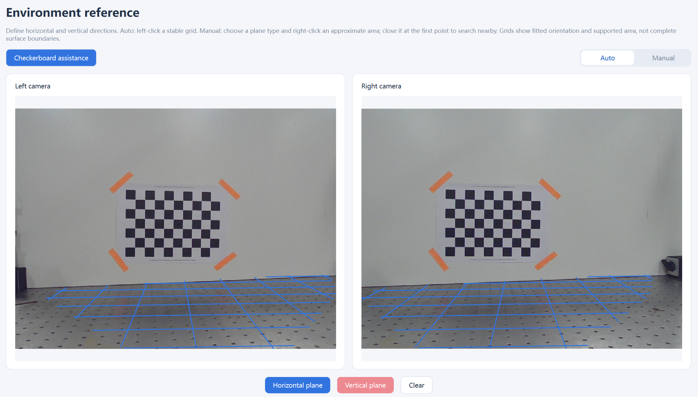
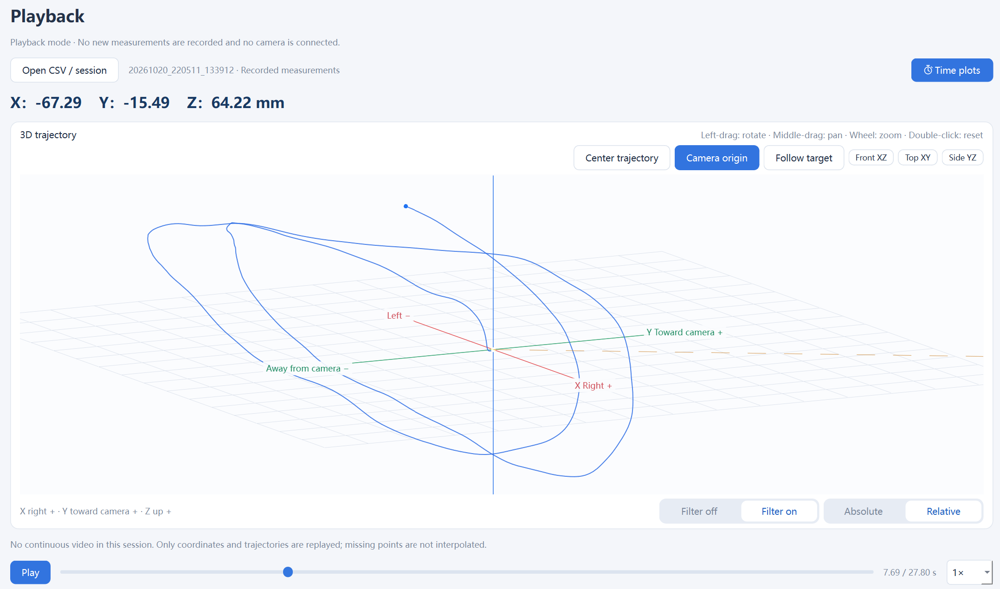
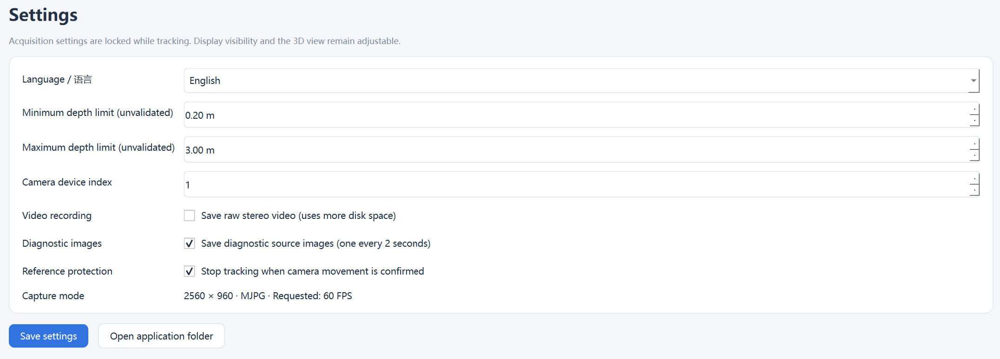
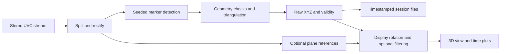

<div align="center">

# Stereo Motion Measurement

**From stereo camera images to inspectable 3D motion.**

A Windows desktop application for tracking a black circular marker, visualizing its trajectory, and reviewing recorded measurements.


[Get started](#quick-start) · [Features](#features) · [Algorithms](#how-it-works) · [Data](#data-and-session-format) · [Limitations](#known-limitations) · [Roadmap](#roadmap)

**A software made by Siri.y**

</div>

<!-- After uploading your own screenshot, uncomment this line. -->


## Overview

Stereo Motion Measurement brings stereo acquisition, marker detection, triangulation, visualization, and session management into one desktop interface. It is intended for small-scale motion experiments, educational stereo-vision work, and investigation of practical tracking problems.

The project started from an interest in VR-style handheld tracking: seeing a real object's movement appear as a three-dimensional trajectory on screen. The current release focuses on a simpler, inspectable target: **one solid black circle on a light background**.

**Open camera → select the marker in both views → start tracking → move → stop and save → replay and inspect.**

Raw measurements remain available alongside derived coordinates and filtered estimates. Tracking failures are recorded explicitly instead of being silently replaced with a predicted path.

> **Current scope:** single-marker position tracking. Colored-ball tracking, geometric sphere-center estimation, multiple objects, and IMU integration are future work. This release does not provide complete 6-DoF VR tracking or general-purpose scene reconstruction.

## Contents

- [Quick start](#quick-start)
- [Hardware and calibration](#hardware-and-calibration)
- [Features](#features)
- [Using the application](#using-the-application)
- [Coordinates and reference frames](#coordinates-and-reference-frames)
- [How it works](#how-it-works)
- [Data and session format](#data-and-session-format)
- [Run and build from source](#run-and-build-from-source)
- [Validation and performance](#validation-and-performance)
- [Troubleshooting](#troubleshooting)
- [Known limitations](#known-limitations)
- [Roadmap](#roadmap)
- [Contributing](#contributing)
- [Acknowledgments and licensing](#acknowledgments-and-licensing)

## Quick start

### Portable Windows application

1. Open [Releases](https://github.com/sirikiki/Stereo-Motion-Measurement/releases) and download the Windows x64 ZIP when an asset is available. **Code → Download ZIP** contains source code, not the ready-to-run application.
2. Extract the **entire** archive to a writable folder. Do not run the EXE from inside the ZIP.
3. Keep `Stereo Motion Measurement.exe`, `_internal`, `assets`, `config`, and `calibration` together in the extracted application folder.
4. Double-click `Stereo Motion Measurement.exe`. Python is not required for the portable application.

The app starts with the camera off. You can inspect its interface and load a compatible recording without connecting a camera.

### First tracking session

1. Check the [calibration requirements](#hardware-and-calibration). The included calibration is device-specific.
2. Connect the stereo camera and close other applications using it.
3. In **Settings**, set **Camera device index** if necessary and click **Save settings**.
4. Click **Open camera**. Confirm that both rectified images are visible.
5. Place a solid black circular marker on a light card in the shared field of view. Click its center in each camera image.
6. Click **Start tracking**. Confirm valid XYZ coordinates, then move the target while keeping it visible in both views.
7. Click **Stop tracking**. The session is saved automatically, its result stays on screen, and preview can remain open.
8. In **Sessions**, select the recording and click **Play session**.

If tracking is lost, check visibility and lighting, then select the target again in both views. Reselection also works during tracking.

## Hardware and calibration

| Item | Current implementation |
| --- | --- |
| Tested operating system | Windows 11, 64-bit |
| Development camera | DECXIN-3412V1 integrated UVC stereo module |
| Capture backend | OpenCV DirectShow |
| Requested stream | MJPG, 2560 × 960, 60 FPS |
| Input layout | Two side-by-side 1280 × 960 views |
| Tracking target | One solid black circle with a light surrounding area |
| Typical initial experiments | Approximately 0.6–0.8 m from the camera |
| Graphics | An OpenGL-capable graphics driver |

These are implementation assumptions, not universal UVC compatibility or a validated operating envelope. Requesting 60 FPS does not establish actual frame delivery, synchronized exposure, or 60 valid 3D points per second.

Use a rigid support, stable lighting, a matte marker, and a clearly visible light border. Set physical focus before validating calibration; the application does not provide automatic optical focusing.

### Device-specific calibration

The included `calibration/stereo_calibration.npz` belongs to the original development setup. **It is not a universal calibration for another camera**, even another unit of the same model.

This release loads existing parameters and does not provide an end-user calibration wizard. Obtain a compatible stereo calibration before trusting another camera's measurements. Changes to focus, resolution, or relative camera mounting can affect applicability. Moving the whole rigid assembly is different from changing its stereo geometry, but any previous environment reference must be reconsidered.

<details>
<summary><strong>Calibration file requirements</strong></summary>

The NPZ is loaded with `allow_pickle=False`. Core reconstruction expects:

| Key | Meaning |
| --- | --- |
| `units` | Scalar string `m` |
| `image_size` | Per-view `[width, height]` |
| `K_left`, `K_right` | Intrinsic matrices |
| `D_left`, `D_right` | Distortion coefficients |
| `R1`, `R2` | Rectification rotations |
| `P1`, `P2` | Rectified projection matrices; translation uses meters |

Incoming frame size must match calibration. Keep the complete original NPZ for optional reference modules. Supporting a different camera format can also require changes to capture settings in source.

</details>

## Features

| Area | Available now |
| --- | --- |
| **Monitor** | Stereo preview, marker overlays, live XYZ, full-session 3D trajectories, independent preview and recording |
| **3D interaction** | Rotate, pan, zoom, Monitor expand/restore, front/top/side views, fit trajectory, follow latest point, camera-origin visibility |
| **Position modes** | Absolute camera-origin coordinates and displacement from the session's first valid point, switchable live and in playback |
| **Filtering** | Optional One Euro filtering; raw measurements remain available |
| **Environment reference** | Independent horizontal/vertical references, automatic candidates, manual region guidance, checkerboard assistance |
| **Time plots** | Separate X/Y/Z curves from current or loaded sessions |
| **Accuracy validation** | General A1 → B → A2 displacement, stationary variation, and return-deviation checks |
| **Sessions** | Automatic saving, metadata, notes, folder access, single/batch deletion, undo for the most recent deletion batch |
| **Playback** | CSV loading, play/pause, seeking, 0.25× / 0.5× / 1× / 2× speeds, direct access to curves and return |
| **Settings** | English/Simplified Chinese, camera index, depth limits, video, diagnostic images, reference protection |

Collapse the sidebar or independently hide images, trajectory, XYZ, and detection overlays. Hiding a display does not stop measurement and saving.

## Using the application

### Monitor and 3D controls

| Control | Action |
| --- | --- |
| **Open camera / Close camera** | Toggle preview; closing during tracking finalizes the session |
| **Start tracking / Stop tracking** | Create and finish an automatically saved session |
| Left-click a camera image | Select/reselect the marker in that view |
| Left-drag the 3D view | Rotate |
| Middle-drag | Pan |
| Mouse wheel | Zoom |
| Double-click the 3D view | Reset and fit |
| Expand icon on Monitor | Expand into the work area; click again or press **Esc** to restore |
| **Center trajectory** | Fit the currently available trajectory |
| **Follow target** | Center the latest valid point; manual view manipulation can interrupt following |
| **Camera origin** | Show/hide the optical-origin marker, label, and guide |
| **Front XZ / Top XY / Side YZ** | Select a standard view |
| **Absolute / Relative** | Change position reference without rewriting raw XYZ |
| **Filter off / Filter on** | Switch raw/filtered display |

The full current-session trajectory is retained rather than disappearing after a rolling time window. Very long recordings can therefore increase memory and rendering cost.



### Time plots

Choose **Time plots** to inspect X, Y, and Z against elapsed time. Select the current or last loaded session, or import a compatible CSV. The curves use the applicable display orientation and position/filter modes. Invalid observations create gaps.

Plots can reveal depth changes or cross-axis motion that is difficult to judge from a 3D viewing angle. From **Playback**, the blue **Time plots** button opens the loaded recording's curves; **Back** returns to playback.



### Optional environment reference

A tilted camera can make physically level motion change several camera coordinates. A user-selected reference defines which direction should represent horizontal or vertical. The transform is a rigid rotation: it does not flatten real motion or improve underlying depth measurements.

Set references **before a session**:

1. Open the camera and navigate to **Environment reference**.
2. Choose **Auto** or **Manual** at the top right.
3. Select **Horizontal plane** or **Vertical plane**. Either can be set alone; both and either order are supported.
4. **Auto:** keep the scene still until a stable candidate appears. Hover over an outline to preview a grid; left-click to confirm.
5. **Manual:** right-click at least three points in either image, then click the first point to close the outline. This suggests an approximate region; the software searches in and around it for a supported plane. **Backspace** removes a point; **Esc** resets an unfinished outline.
6. **Clear** removes references. During manual analysis, cancellation is available instead.

| Reference | Orientation |
| --- | --- |
| None | Default camera-based convention |
| Horizontal only | Z follows the upward plane normal; other directions remain close to the default |
| Vertical only | Default up is retained; the plane refines horizontal heading |
| Both | Horizontal defines up and vertical refines heading; incompatible directions are rejected |

An unset/active reference uses red feedback, an accepted reference green, and an existing reference blue while the other type is selected. Grids appear only on this page. They indicate fitted orientation and supported area, not a semantic outline of an entire desk or wall.

For weak texture, enable **Checkerboard assistance**. Use **10 × 7 squares, 25 mm per square**, giving **9 × 6 inner corners**. Place it flat against the actual reference surface, completely visible in both views. The fitting uses a central corner subset to reduce sensitivity to curved outer edges; a flat central region is still necessary. This establishes direction rather than recalibrating the stereo camera.

References can be reused across sessions while the application and reference workflow remain active. Occlusion alone does not delete them. Clear them after moving the camera. Closing the application or camera reference workflow clears active references; saved sessions retain their own snapshots for playback.

**Reference protection** uses background features and repeated geometric consistency checks to look for camera movement. By default, confirmation clears the reference, stops and saves tracking, and shows an alert. With **Stop tracking when camera movement is confirmed** disabled, raw recording continues while invalid environment-coordinate display is suspended. A scene with insufficient background information can prevent reliable movement detection.



### Accuracy validation: A1 → B → A2

This checks a known displacement and return repeatability, independently of pendulum analysis.

1. Fix the marker to a support with a repeatable positioning reference.
2. Establish A and B using a measured separation; prefer a guide or stops over freehand positioning.
3. Enter **Reference displacement**, in millimeters.
4. Start tracking and confirm valid XYZ.
5. Hold at A and click **Record A1 · 5 s**.
6. Move to B, hold still, and click **Record B · 5 s**.
7. Return to A, hold still, and click **Return to A · 5 s**.
8. Review measured displacement, difference from the reference, each stage's standard deviations, and return-to-A deviation.

A stage participates only with at least **20 valid points**, **80% valid frames**, and **4.5 seconds** of coverage. Repeated attempts are retained; the latest attempt for each stage is used.

Static standard deviation measures short-term variation, not absolute accuracy. Reference spacing, positioning, marker geometry, and calibration uncertainty still matter.

### Sessions and playback

Each run has its own timestamped directory. **Sessions** shows counts, valid rate, and completion status. Notes are saved separately from raw CSV. **Open folder** opens the selected session directory.

Use the red trash button for a selected record, or **Batch delete** for several. Deleted sessions move to the application recycle folder. **Undo delete** restores the most recent deletion batch during the current application run.

Use **Play session** or **Playback → Open CSV / session** to replay. Stop active tracking first. Playback supports speed changes, timeline seeking, position/filter modes, and the recording's saved environment reference when available.

**Continuous video is not synchronized into playback in this release.** Coordinates and trajectories can play without video. A CSV without its report can be loaded, but missing metadata limits reconstruction of the original reference context.



### Settings

- **Language / 语言:** English or 简体中文. Close the camera first; switching saves the preference and rebuilds the idle interface.
- **Minimum / Maximum depth limit:** rejection thresholds in meters. Defaults 0.2 and 3.0 m are not a validated tracking range.
- **Camera device index:** OpenCV device index, which can change after reconnection.
- **Video recording:** optional raw stereo MJPG video; off by default.
- **Diagnostic images:** original stereo images approximately every two seconds during recording; on by default.
- **Reference protection:** stop and save when camera movement is confirmed; on by default.

Click **Save settings** after changing acquisition options. Acquisition parameters are locked during tracking; visibility and the 3D view remain adjustable.



## Coordinates and reference frames

By default, directions are defined for a person facing the camera:

| Axis | Positive direction |
| --- | --- |
| **X** | The person's right |
| **Y** | Toward the camera |
| **Z** | Up in the camera-based convention |

Without an external reference these are camera-related directions, not measured gravity. Environment references rotate this convention.

Let `p` be the raw point in rectified first-camera coordinates, `R` the saved display rotation, and `p0` the first valid point after Start:

```text
absolute display position = R · p
relative display position = R · (p − p0)
```

- Absolute origin: the rectified first-camera optical center, not a surveyed laboratory origin.
- Relative origin: fixed at `p0` for the session.
- UI: millimeters. CSV fields ending `_m`: meters.
- Both coordinate modes are recorded alongside raw XYZ.
- Changing the 3D viewing angle does not change measurement coordinates.

## How it works



| Stage | Method | Source |
| --- | --- | --- |
| Rectification | OpenCV undistortion/rectification maps from stored calibration | `stereo_reconstruction.py` |
| Marker detection | Grayscale, bounded Otsu threshold, contours, image moments, contrast/shape/size checks near a seed | `marker_tracking.py` |
| Point reconstruction | Epipolar consistency, homogeneous triangulation, depth limits, reprojection rejection | `stereo_reconstruction.py` |
| Natural reference planes | StereoSGBM, optional brightness normalization and temporal depth median, robust/RANSAC-based fitting, connected support, multi-frame stability | `environment.py`, `plane_selection.py`, `plane_patches.py` |
| Checkerboard assistance | Stereo corner triangulation, rigid-pose initialization, SciPy joint reprojection optimization | `board_reference.py` |
| Camera-movement checks | ORB matching and PnP/RANSAC with repeated confirmation | `environment.py` |
| Filtering | 3D speed-norm adaptation of One Euro | `filtering.py` |
| Persistence | Queued CSV writing, JSON metadata, explicit validity, timestamp-based playback | `storage.py`, `capture.py` |

Modules are under `source/`. Dense stereo is used for optional plane references; marker tracking triangulates the two detected image centers and does not require dense scene reconstruction for every target measurement.

One Euro adapts cutoff with estimated speed to trade smoothness against responsiveness. Filtering can lag and suppress real small motion. It cannot classify motion intent. Invalid input resets the filter, preserving gaps.

This project integrates established algorithms into an inspectable measurement workflow. It does not claim a new stereo or filtering algorithm.

## Data and session format

```text
Stereo Motion Measurement/
├── Stereo Motion Measurement.exe
├── _internal/                 # Bundled runtime; keep with EXE
├── assets/
├── calibration/stereo_calibration.npz
├── config/
│   ├── defaults.json
│   └── settings.json          # Local preferences; ignored by Git
├── source/
├── data/sessions/<session-id>/
│   ├── measurements.csv
│   ├── report.json
│   ├── calibration.npz
│   ├── notes.json             # If a note is saved
│   ├── diagnostic_images/     # If enabled
│   ├── raw.avi                # If enabled
│   └── error.txt              # On error
└── logs/application.log
```

Portable packages start without previous experiments. Data, logs, and recycle folders are generated as needed and excluded from source control.

<details>
<summary><strong>Important CSV fields</strong></summary>

| Field/group | Meaning |
| --- | --- |
| `host_read_complete_ns` | Monotonic host read-completion timestamp, nanoseconds |
| `valid` | Whether the implemented target checks passed |
| `x_m`, `y_m`, `z_m` | Raw rectified-camera XYZ, meters |
| `left_u_px`, `left_v_px`, `right_u_px`, `right_v_px` | Rectified image centers, pixels |
| `vertical_error_px`, `disparity_px` | Stereo consistency information |
| `reason` | Success/failure reason |
| `relative_camera_*_m` | Displacement from first valid point in raw camera axes |
| `display_absolute_*_m`, `display_relative_*_m` | Coordinates after the saved display rotation |
| `filtered_camera_*_m` | Filtered estimate, distinct from raw XYZ |
| `environment_valid` | Environment-reference validity |
| `phase`, `attempt`, `phase_elapsed_s` | Free-motion / validation-stage bookkeeping |
| `diagnostic_image` | Diagnostic image filename when saved for that row |

Invalid observations have explicit status and missing coordinates. Playback leaves gaps instead of interpolating measurements. `report.json` records settings, calibration SHA-256, coordinate-origin policy, environment snapshot/events, filter parameters, row counts, status, and available validation summaries. Keep it with the CSV.

</details>

### Timing and privacy

Host read completion is **not** hardware exposure time or measured end-to-end latency. Video uses a fixed 60 FPS container; CSV host timestamps are the measurement time reference, and variable delivery can make video timing differ.

The app records locally and has no built-in telemetry or automatic cloud upload. Diagnostic images/video may contain people, screens, or room details. Review them before sharing and select individual sessions deliberately.

## Run and build from source

The capture implementation targets Windows; other operating systems are unvalidated. Install **64-bit Python 3.11**, then use PowerShell:

```powershell
git clone https://github.com/sirikiki/Stereo-Motion-Measurement.git
cd Stereo-Motion-Measurement
py -3.11 -m venv .venv
.\.venv\Scripts\python.exe -m pip install -r requirements.txt
Copy-Item config/defaults.json config/settings.json
.\.venv\Scripts\python.exe source/app.py
```

Copy defaults only on a fresh checkout; do not overwrite existing preferences unnecessarily. Calling virtual-environment Python directly avoids needing a PowerShell activation-policy change.

See [`requirements.txt`](requirements.txt) for pinned NumPy, OpenCV, SciPy, PySide6, pyqtgraph, PyOpenGL, and PyInstaller versions. The current implementation needs no CUDA, PyTorch, ROS, or pretrained model.

### Build a portable folder

```powershell
.\.venv\Scripts\python.exe build.py
```

Output: `dist/Stereo Motion Measurement/`. Distribute the entire folder. The build uses clean defaults and does not copy experiment history. Build output, EXEs, runtime libraries, local settings, acquired data, and logs are ignored by Git.

### Offline GUI self-check

A clean portable copy can run without opening a camera:

```powershell
$env:SMM_QA_DIR = Join-Path $env:TEMP "StereoMotionQA"
& ".\Stereo Motion Measurement.exe" --smoke-test
```

This developer check expects no existing sessions. It uses temporary synthetic CSV data, exercises interface/playback, writes results and screenshots to the chosen QA directory, and exits. It is not a hardware or accuracy test and is not required for normal use.


## Troubleshooting

| Symptom | Checks and next steps |
| --- | --- |
| No image | Click **Open camera**; check device index, USB, Windows camera access, and competing camera apps. |
| Frame size differs from calibration | Match incoming layout/resolution to the NPZ and supported capture request. |
| Dark/blurred image | Remove covers, improve lighting, set physical focus, then check calibration applicability. |
| Visible target but no green circle | Select it in both views; check its light border, size, contrast, perspective, reflections, and occlusion. |
| No recovery after occlusion | Reselect. The current detector has a 100-pixel center-displacement gate; enlarging the ROI does not remove that gate. |
| Green circles but no XYZ | Green circles indicate 2D detection only; geometry/depth/reprojection checks can reject the pair. |
| Horizontal movement changes Z | Check camera tilt/reference and actual cross-axis motion; use a real level plane when needed. |
| Desk/wall rejected | Try a larger textured area, better lighting, or a flat checkerboard. Weak texture and mixed surfaces can defeat stereo. |
| Gaps in plots | Inspect CSV validity/reason and environment validity. Gaps represent rejected observations. |
| Slow 3D view | Try hiding images, reduce GPU load, check graphics drivers, and consider full-session trajectory cost. |
| Language will not switch | Close the camera first. |
| Copied EXE fails | Extract the whole portable ZIP and keep `_internal` beside the EXE. |

## Known limitations

- One seeded black-circle target on a light background; no arbitrary-object or colored-sphere support yet.
- Image-centroid triangulation is approximate. Perspective affects planar-circle centers; geometric sphere-center estimation is future work.
- Capture layout, requests, and calibration handling follow the development camera setup.
- Large post-occlusion motion and similar dark distractors can defeat tracking; recovery is not guaranteed.
- Experimental plane references struggle with weak texture, reflections, clutter, shadows, and slanted surfaces. They do not semantically distinguish desks, walls, screens, and outlets.
- Filtering can alter real small motion and cannot infer intent.
- IMU fusion, complete 6-DoF tracking, synchronized video playback, a calibration wizard, and a global accuracy/latency specification are not provided.
- Full-session visualization has increasing memory/rendering cost for long recordings.

## Roadmap

These are intended priorities, not committed release dates.

- [x] Stereo preview, seeded marker tracking, quality-gated triangulation
- [x] Interactive trajectories, raw/filtered and absolute/relative displays
- [x] Automatic recording, metadata, session management, curves, CSV playback
- [x] Optional plane references and checkerboard assistance
- [x] English and Simplified Chinese interfaces
- [ ] Improve occlusion recovery, distractor handling, and failure diagnostics
- [ ] Add colored-ball tracking and evaluate geometric sphere-center estimation
- [ ] Improve plane-reference responsiveness and weak-texture guidance
- [ ] Collect/time-align IMU data before evaluating fusion benefits
- [ ] Evaluate multiple objects after documenting a single-target operating envelope
- [ ] Publish selected, privacy-reviewed example sessions and repeatable evaluation procedures

## Contributing

Reproducible issues are useful. Include:

1. Revision, Windows version, and EXE versus Python execution.
2. Camera model, device index, actual frame size, and calibration context.
3. Reproduction steps and expected versus observed behavior.
4. Relevant error text and a short privacy-reviewed CSV/report or stereo image pair.
5. Whether environment references and filtering were enabled.

Distinguish captured data from synthetic inputs and preserve missing observations. Do not attach credentials or unreviewed personal footage. Source changes should explain the behavior and appropriate validation.

## Acknowledgments and licensing

- [OpenCV calibration and 3D geometry](https://docs.opencv.org/4.x/d9/d0c/group__calib3d.html): rectification, StereoSGBM, and triangulation.
- [NumPy](https://numpy.org/) and [SciPy](https://scipy.org/): numerical operations and optimization.
- [Qt for Python / PySide6](https://doc.qt.io/qtforpython-6/), [pyqtgraph](https://github.com/pyqtgraph/pyqtgraph), and [PyOpenGL](https://pyopengl.sourceforge.net/): interface and visualization.
- [One Euro Filter](https://github.com/casiez/OneEuroFilter), Casiez, Roussel, and Vogel, CHI 2012: adapted here using a 3D speed norm.
- [PyInstaller](https://pyinstaller.org/): portable Windows packaging.

Developed with AI-assisted software coding and debugging alongside hands-on setup, experiments, and user feedback. Established algorithms and external libraries are credited separately from project-specific engineering work.

**Project license selection is pending.** This README does not declare an MIT, Apache, or other project-wide license. Third-party components retain their own licenses; supplied dependency notices should be preserved with distributions.

---

<div align="center">

**A software developed by Siri.y — and no, not *that* Siri on your iPhone :D**

Built for experiments that can be inspected, replayed, and questioned.

</div>
